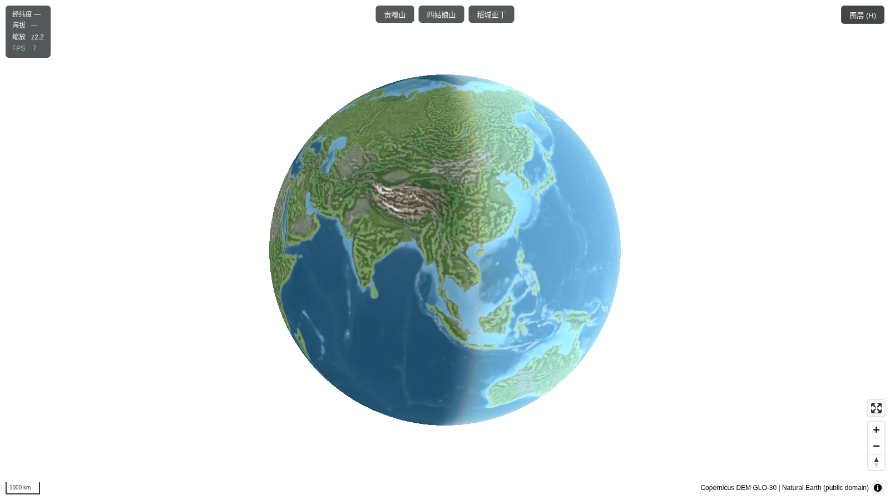
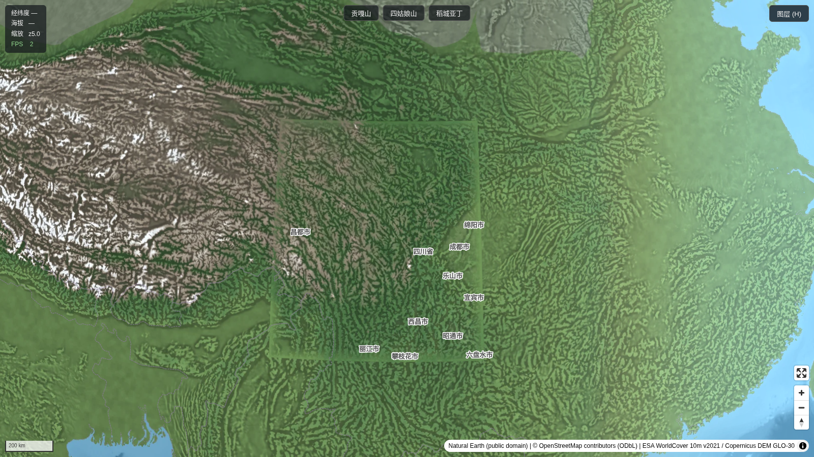
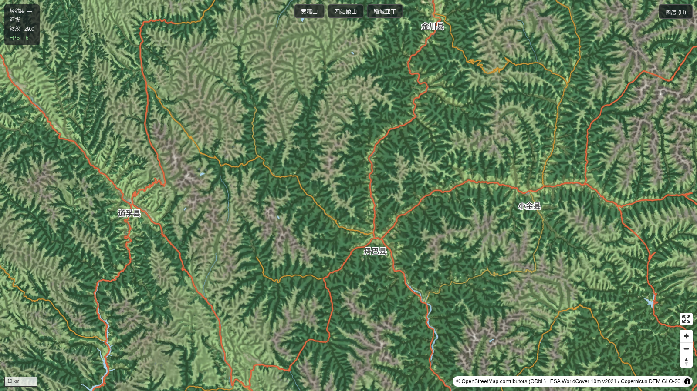
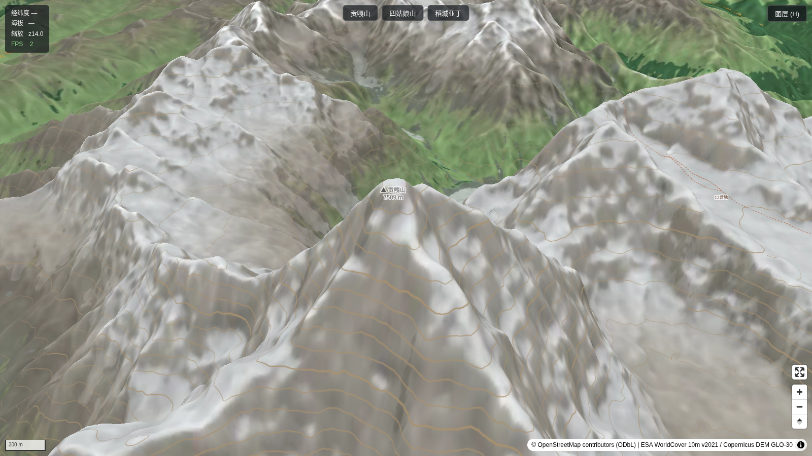
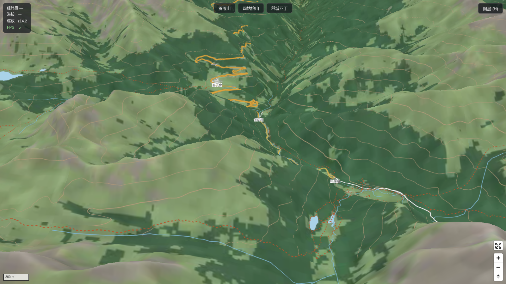
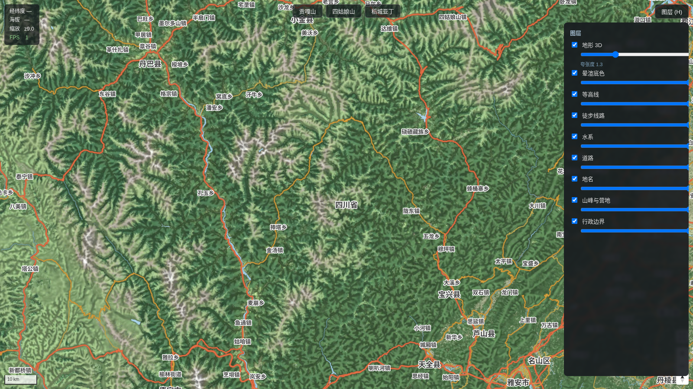

# 川西 3D 户外地图

浏览器内可自由转动的 3D 地球 + 真 3D 地形 + 矢量户外地图。纯静态、无后端、全本地数据。

## 快速开始

**数据不在仓库里**（产物 ~2.65GB，不入 git）。一条命令全自动下载+处理（约 7GB 下载，数小时；幂等可中断续跑）：

```bash
bash pipeline/fetch-all.sh            # 默认川西 bbox 96,26,105,35；换区域传参即可
npm install && npm run dev            # http://localhost:5271
```

<details><summary>分步执行（排障/自定义时）</summary>

```bash
bash pipeline/00-fetch-osm.sh        # 下载并裁切 OSM（~1.7GB 下载）
bash pipeline/01-fetch-dem.sh        # 下载 Copernicus DEM 81 片（~4GB，8 并发断点续传）
bash pipeline/02-fetch-worldcover.sh # 下载 ESA WorldCover 12 片（~1.2GB）
bash pipeline/05-world.sh            # Natural Earth → world.pmtiles
bash pipeline/06-dem.sh              # DEM 拼接重投影 → data/work/dem_3857.tif
# Rust 工具（首次需 cargo build --release）
(cd rust/geotiles && cargo build --release)
rust/geotiles/target/release/dem2tiles --input data/work/dem_3857.tif --output data/work/dem.mbtiles
rust/geotiles/target/release/bake-relief --dem data/work/dem_3857.tif --landcover data/work/worldcover_3857.tif --output data/work/relief.mbtiles
bash pipeline/03b-fetch-planetiler-sources.sh # planetiler 辅助数据（水多边形/湖线/NE）
bash pipeline/03-osm-to-pmtiles.sh   # planetiler → osm.pmtiles
bash pipeline/04-hiking.sh           # 徒步线路 → hiking.pmtiles
bash pipeline/08-glyphs.sh           # 中文字体字形
bash pipeline/07-pmtiles.sh          # 汇总校验

# 3. 启动
pnpm install
pnpm dev      # 开发（Vite，端口 5271，支持 Range，PMTiles 可用）
pnpm serve    # 生产验证（vite build + node scripts/prod-server.mjs，端口 5272）
```

</details>

打开 http://localhost:5271 —— 3 秒内应看到地球。
（5173 被本机其他项目占用，故改用 5271/5272；`npx serve` 实测不跟随指向 dist 外的符号链接，
故生产静态服务器用自带的 `scripts/prod-server.mjs`（原生支持 Range + .mjs MIME）。）

## ⚠️ Range 服务器警告

PMTiles 依赖 HTTP Range 请求。**必须**用支持 Range 的静态服务器（Vite dev server、`scripts/prod-server.mjs` 都可以）。
**绝对不要用 `python3 -m http.server`** —— 它不支持 Range，会把整个 GB 级文件拉进内存，直接卡死。

## 依赖安装

| 工具 | 安装方式 |
|---|---|
| Node.js ≥ 20 | 系统自带或 nvm |
| pnpm | `npm i -g pnpm`（或用 `corepack`，亦可全程用 npm 代替） |
| JDK ≥ 21 | `tools/micromamba create -p tools/mambaenv -c conda-forge openjdk` |
| GDAL / tippecanoe / osmium-tool | 同上 micromamba 环境（`gdal tippecanoe osmium-tool`） |
| Rust | `curl https://sh.rustup.rs -sSf \| sh` |
| planetiler | `pipeline/03` 自动下载 jar |
| go-pmtiles | GitHub release 二进制（见 NOTES.md） |

micromamba 本身：`curl -Ls https://micro.mamba.pm/api/micromamba/linux-64/latest | tar -xj -C tools --strip-components=1 bin/micromamba`

使用前 `export PATH="$PWD/tools/mambaenv/bin:$PATH"`。

## 换区域

所有 pipeline 脚本接受 bbox 参数：`bash pipeline/01-fetch-dem.sh "minx,miny,maxx,maxy"`。
同步修改 `src/main.ts` 的初始相机与 `style.json`（无区域耦合），以及 `06-dem.sh` 的默认 bbox。

## 快捷键

`T` 切地形 3D，`H` 切图层抽屉，`Esc` 关面板。

## 测试

```bash
node tests/check-bbox.mjs    # 各 pmtiles 元数据与 bbox 比对
node tests/check-dem.mjs     # 已知山峰/城市高程解码校验（±50m）
node tests/check-align.mjs   # 栅格底色与矢量水系对齐校验
node tests/check-size.mjs    # 数据总量 ≤ 2.5GB
node tests/check-no-gcj.mjs  # 无坐标纠偏代码
```

## 数据与署名

代码以 [MIT](LICENSE) 开源。数据产物归各自上游许可约束：

- 矢量要素（osm / hiking）：© OpenStreetMap contributors，[ODbL](https://opendatacommons.org/licenses/odbl/)
- 地形与等高线（dem / contours）：Copernicus DEM GLO-30（[许可](https://spacedata.copernicus.eu/collections/copernicus-digital-elevation-model)，需署名 "© DLR e.V. 2010-2014 and © Airbus Defence and Space GmbH 2014-2018 provided under COPERNICUS by the European Union and ESA; all rights reserved"）
- 户外底色（relief）：ESA WorldCover 10m v2021（CC BY 4.0）+ Copernicus DEM
- 全球底图（world）：Natural Earth，公有领域
- 字形：Noto Sans SC（SIL OFL 1.1）

## 截图

| 地球（全球 ETOPO 粗底） | 川西 z5（200km 比例尺） | 川西 z9 |
|---|---|---|
|  |  |  |

| 贡嘎 3D z14 | 徒步小径 z15 | 图层抽屉 |
|---|---|---|
|  |  |  |
